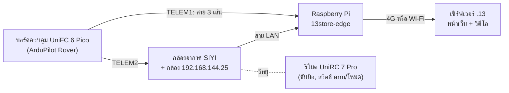

# Raspberry Pi บนรถ: ติดตั้ง Edge Gateway

คู่มือนี้ติดตั้ง Edge Gateway บน Raspberry Pi ที่วางบนตัวรถ (ทาง B ของแผน: รถออกลาดตระเวนไกลจากคนถือรีโมตได้)
Pi ทำงานเหมือนแอป Edge บนรีโมต คือคุยกับบอร์ดควบคุม ส่งตำแหน่งและภาพกล้องขึ้นเซิร์ฟเวอร์ และรับคำสั่งจากหน้าเว็บ
แต่ต่อบอร์ดด้วยสายตรง ไม่ผ่านวิทยุ SIYI



- รีโมต SIYI ยังใช้ขับมือ arm และสลับโหมดได้เหมือนเดิม
- **รถหนึ่งคันใช้ Gateway ตัวเดียว:** เมื่อย้ายมาใช้ Pi ให้กด "หยุด" ในแอป Edge บนรีโมตของรถคันนั้น และไม่ต้องเปิดอีก
  ถ้าเปิดทั้งสองที่ เซิร์ฟเวอร์จะเห็นรถสลับไปมาระหว่างสองเส้นทาง และลดโหมดรถกลับเป็น SHADOW ทุกครั้งที่สลับ
- หลังเปลี่ยนมาใช้ Pi ครั้งแรก รถจะกลับเป็น SHADOW หัวหน้าเวรต้องเลื่อนเป็น LIVE_MANUAL ใหม่ (ระบบตั้งใจให้เป็นแบบนี้: เส้นทางควบคุมเปลี่ยน)

## 1. ของที่ต้องมี

| ชิ้น | หมายเหตุ |
|---|---|
| Raspberry Pi 4 (RAM 2 GB ขึ้นไป) หรือ Pi 5 | Pi 3B+ ก็ใช้ได้ แต่ช้ากว่า |
| microSD 32 GB (A1/A2) | หรือ SSD ถ้ามี |
| ตัวแปลงไฟ DC-DC จากแบตรถเป็น 5 V | Pi 5 ใช้ **5 V 5 A**, Pi 4 ใช้ **5 V 3 A** ไฟตกแล้ว Pi จะรีบูตเอง ห้ามเอาไฟจากบอร์ดควบคุม |
| สาย TELEM1 ของ UniFC (JST-GH 6 ขา) + สายจัมเปอร์ตัวเมีย 3 เส้น | ใช้แค่ TX, RX, GND ถ้าใช้ช่อง UART ของ Pi 5 แทนขา GPIO ใช้หัว JST-SH 3 ขาแทนสายจัมเปอร์ (หัวข้อ 2) |
| สาย LAN จากกล่องอากาศ SIYI | เฉพาะถ้าจะส่งภาพกล้อง ถ้ากล่องมีช่อง LAN ช่องเดียวและกล้องเสียบอยู่ ใช้สวิตช์ LAN 5 V ตัวเล็กคั่น |
| อินเทอร์เน็ต | ทดสอบในสำนักงานใช้ Wi-Fi ได้ ใช้งานจริงใช้ 4G แบบ USB (ชนิดที่ขึ้นเป็นการ์ดเครือข่าย) หรือเราเตอร์ 4G |

## 2. ต่อสายบอร์ด → Pi

**ทางหลัก: TELEM1 เข้าขา GPIO** (หัวฝั่งบอร์ดล็อกแน่น ฝั่ง Pi เป็นสายจัมเปอร์ ควรยึดด้วยกาวร้อนหรือเทปกันหลุดตอนรถสั่น)

| UniFC 6 Pico TELEM1 (ขาแบบ Pixhawk) | Raspberry Pi |
|---|---|
| ขา 1 VCC 5 V | **ไม่ต่อ** |
| ขา 2 TX (บอร์ดส่ง) | ขา 10 (GPIO15, RXD) |
| ขา 3 RX (บอร์ดรับ) | ขา 8 (GPIO14, TXD) |
| ขา 4 CTS, ขา 5 RTS | ไม่ต่อ |
| ขา 6 GND | ขา 6 (GND) |

TX ไขว้ไป RX ทั้งสองฝั่ง สัญญาณเป็น 3.3 V ทั้งคู่ ต่อตรงได้ ดูลำดับขาในคู่มือ UniFC 6 Pico อีกครั้งก่อนต่อ

**Pi 5: ใช้ช่อง UART 3 ขาแทนขา GPIO ได้** ช่องเล็กที่มีคำว่า UART อยู่ระหว่างช่อง micro-HDMI สองช่อง
เป็นหัว JST-SH 1.0 มม. ล็อกแน่นกว่าสายจัมเปอร์ บน Pi ชื่อ `/dev/ttyAMA10` (ขาตามสเปกของ Raspberry Pi: ขา 1 RX, ขา 2 GND, ขา 3 TX)

| UniFC 6 Pico TELEM1 | ช่อง UART ของ Pi 5 |
|---|---|
| ขา 1 VCC 5 V | **ไม่ต่อ** |
| ขา 2 TX (บอร์ดส่ง) | ขา 1 RX |
| ขา 3 RX (บอร์ดรับ) | ขา 3 TX |
| ขา 6 GND | ขา 2 GND |

- ต้องทำสายเอง: หัว JST-SH 3 ขา (ฝั่ง Pi) ต่อกับหัว JST-GH 6 ขา (ฝั่ง TELEM1) แบบไขว้ TX/RX ตามตาราง
- ในหน้าแอดมินเลือกสายต่อบอร์ด "TELEM1 เข้าช่อง UART 3 ขาของ Pi 5 (/dev/ttyAMA10)"
- ช่องนี้เดิมเป็นคอนโซลของ Pi ตัวติดตั้งปิดคอนโซลให้แล้ว ตอนเปิดเครื่อง Pi อาจยังส่งข้อความบูตออกมาสั้น ๆ บอร์ดไม่สนใจเพราะไม่ใช่ MAVLink

ตั้งพารามิเตอร์บอร์ด (Mission Planner) แล้วรีบูตบอร์ด:

| พารามิเตอร์ | ค่า | ทำไม |
|---|---|---|
| `SERIAL1_PROTOCOL` | `2` | MAVLink 2 บน TELEM1 |
| `SERIAL1_BAUD` | `115` | 115200 ตรงกับที่หน้าแอดมินตั้งให้ Pi (UGV-01 เดิมเป็น `57` ต้องเปลี่ยน, UGV-02 เป็น `115` อยู่แล้ว) |
| `BRD_SER1_RTSCTS` | `0` | ไม่ได้ต่อสาย CTS/RTS |
| `SYSID_MYGCS` | `255` (ค่าเดิม) | บอร์ดรับคำสั่งขับจาก Gateway ที่เป็น 255 |
| `FS_GCS_ENABLE` | `1` (มีอยู่แล้ว) | ถ้า Pi ดับหรือสายหลุด บอร์ดหยุดรถเอง (Hold) |

TELEM2 ยังต่อกับกล่องอากาศ SIYI เหมือนเดิม ไม่ต้องแก้

**ทางสำรอง: สาย USB** จากช่อง USB-C ของบอร์ดเข้า Pi ง่ายกว่า ไม่ต้องตั้งพารามิเตอร์ แต่สายหลุดง่ายกว่า
ในหน้าแอดมินเลือก "สาย USB (/dev/ttyACM0)" ถ้าใช้โมเด็ม 4G แบบ USB ด้วย ดูชื่อที่ถูกด้วย `13store-edge ports`
(โมเด็มบางรุ่นก็ขึ้นเป็น ttyACM) แล้วใส่ชื่อ `/dev/serial/by-id/usb-ArduPilot_...` ในช่องแก้รายการอุปกรณ์ (JSON) แทน

## 3. เตรียม Pi

1. ในเครื่อง Windows เปิด **Raspberry Pi Imager** เลือก **Raspberry Pi OS Lite (64-bit)** แล้วกดเฟืองตั้งค่า:
   ชื่อเครื่อง (เช่น `ugv01-pi`), ชื่อผู้ใช้และรหัสผ่าน (ตั้งเอง ไม่ต้องบอกใคร), Wi-Fi ของสำนักงาน, เปิด SSH
2. ใส่การ์ดใน Pi แล้วเปิดไฟ รอ 1–2 นาที
3. จาก Windows (PowerShell): `ssh ชื่อผู้ใช้@ugv01-pi.local`

## 4. ติดตั้ง

1. ในเครื่องที่มีโค้ด สร้างชุดติดตั้ง: `npm run kit:pi` ได้ไฟล์ `deploy/pi/dist/13store-edge-pi.tar.gz`
2. คัดลอกไปที่ Pi: `scp deploy/pi/dist/13store-edge-pi.tar.gz ชื่อผู้ใช้@ugv01-pi.local:`
3. บน Pi:
   ```bash
   tar xzf 13store-edge-pi.tar.gz && cd 13store-edge-pi && sudo bash install.sh
   sudo reboot
   ```
   ตัวติดตั้งลง Node.js และ ffmpeg จาก apt, สร้างผู้ใช้ระบบ `edge`, ติดตั้งบริการ `13store-edge` ให้เริ่มเองตอนเปิดเครื่อง
   และเปิด UART บนขา GPIO14/15 เป็น `/dev/ttyAMA0` (Pi 3/4 ปิด Bluetooth ให้, Pi 5 เปิด `uart0`) จึงต้องรีบูตหนึ่งครั้ง
4. หลังรีบูต `13store-edge ports` ต้องเห็น `/dev/ttyAMA0` (ช่อง UART ของ Pi 5 คือ `ttyAMA10`, สาย USB คือ `ttyACM0`)

ติดตั้งซ้ำได้: ใช้อัปเดตชุดใหม่ การจับคู่และสถานะเดิมยังอยู่

## 5. เครือข่าย

**พอร์ต LAN ไปกล่อง SIYI** (สั่งตอน SSH ผ่าน Wi-Fi ไม่ใช่ผ่านสาย LAN):
```bash
sudo 13store-edge siyi-lan
```
ตั้งพอร์ต `eth0` เป็น `192.168.144.101` แบบไม่ใช่เส้นทางอินเทอร์เน็ต แล้วลอง ping กล้อง `192.168.144.25`
ที่อยู่อื่นใส่ต่อท้ายได้ เช่น `sudo 13store-edge siyi-lan 192.168.144.102` (ห้ามใช้ .11 .12 .20 .25 .26 .50 .60 ที่ SIYI จองไว้)

**อินเทอร์เน็ต:** Wi-Fi ตั้งไว้แล้วตอนเตรียมการ์ด ถ้าใช้ 4G แบบ USB ส่วนใหญ่เสียบแล้วใช้ได้เลย เช็คด้วย `ip route` ว่ามีบรรทัด `default`

> **สำคัญ:** เซิร์ฟเวอร์ .13 (`192.168.20.13`) เป็นที่อยู่ในวงแลนของสำนักงาน **ถ้า Pi ออกเน็ตทาง 4G จะเข้าไม่ถึง**
> ต้องมี VPN (เช่น WireGuard หรือ Tailscale) หรือเซิร์ฟเวอร์ที่มีที่อยู่สาธารณะก่อน ทดสอบในสำนักงานให้ใช้ Wi-Fi ของสำนักงาน

## 6. จับคู่กับเซิร์ฟเวอร์

1. ลงทะเบียนรถในการ์ด "Edge Gateway และอุปกรณ์" ก่อน (เหมือนแบบรีโมต) ถ้าลงทะเบียนไว้แล้วข้ามได้
2. หน้าเว็บ › แอดมิน › **จับคู่รีโมต (Edge)**:
   - Gateway ทำงานที่: **Raspberry Pi บนรถ**
   - รหัสรถ, ที่อยู่กล้อง, สายต่อบอร์ด (ขา GPIO, ช่อง UART ของ Pi 5 หรือ USB) แล้วกด **สร้างรหัสจับคู่**
3. หน้าเว็บขึ้นคำสั่งให้พิมพ์บน Pi เช่น
   ```bash
   sudo 13store-edge pair http://192.168.20.13:8090 123456
   ```
   Pi ได้คีย์ Gateway จากเซิร์ฟเวอร์โดยตรง (ไม่มีใครเห็นคีย์) บันทึกไว้ที่ `/etc/13store-edge/site.json` แล้วเริ่ม Gateway เอง
   รหัสใช้ได้ครั้งเดียวภายใน 10 นาที จับคู่ใหม่เมื่อไหร่ คีย์เก่าของ Gateway นี้ถูกยกเลิกทันที

## 7. ตรวจว่าใช้ได้

```bash
13store-edge status
```
ตัวอย่างเมื่อทุกอย่างปกติ:
```
Gateway edge-pi-ugv-01
เซิร์ฟเวอร์   เชื่อมต่อแล้ว · ws://192.168.20.13:8090
UGV-01       รถส่งข้อมูลอยู่ (ล่าสุด 0.3 วินาที) · วิดีโอ กำลังส่ง (h264)
บริการ: active · ชุดติดตั้ง 1a2b3c4
```

| เห็นแบบนี้ | แก้ |
|---|---|
| `ยังต่อไม่ได้ (เช็คเน็ต 4G / Wi-Fi)` | `ping 192.168.20.13`, ดูหัวข้อ 5 เรื่อง 4G |
| `ไม่รับกุญแจของเครื่องนี้` | สร้างรหัสใหม่แล้ว `sudo 13store-edge pair` อีกครั้ง |
| `ไม่ได้ยินรถ` | ไฟบอร์ด, สาย TX/RX สลับกันหรือยัง, `SERIAL1_BAUD = 115`, `13store-edge ports` |
| `เซิร์ฟเวอร์ไม่รับ: Device is not registered…` | ลงทะเบียนรถในหน้าแอดมิน (หัวข้อ 6 ข้อ 1) |
| `วิดีโอ ลองใหม่` | `ping 192.168.144.25`, สาย LAN, `sudo 13store-edge siyi-lan` |
| `Gateway ไม่ได้ทำงาน` | `13store-edge logs` ดูข้อความล่าสุด |

## 8. ทดสอบก่อนวิ่งจริง (ยกล้อลอยพ้นพื้น)

1. `13store-edge status` ปกติ และหน้าเว็บเห็นรถออนไลน์ มีภาพ
2. หัวหน้าเวรเลื่อนรถเป็น LIVE_MANUAL แล้วลองขับจากเว็บ ล้อหมุนตามคำสั่ง
3. **ดึงสาย TELEM1 ออก** ระหว่างล้อหมุน: บอร์ดต้องหยุดล้อเอง (GCS failsafe → Hold) เสียบกลับแล้ว status กลับมาเองใน 2–3 วินาที
4. **ปิด Wi-Fi/4G** ระหว่างขับจากเว็บ: ล้อต้องหยุดภายในครึ่งวินาที (คำสั่งขับหยุดมา Gateway ก็หยุดส่ง)
5. **ถอดไฟ Pi:** บอร์ดหยุดล้อเอง เปิดไฟกลับ Pi เริ่ม Gateway เองโดยไม่ต้องมีใครกด
6. สลับรีโมตเป็นโหมดขับมือ: คนถือรีโมตยังคุมรถได้ทุกเมื่อ

## 9. เมื่อมีอะไรหลุด รถทำอะไร

| เหตุ | ผล |
|---|---|
| เน็ต 4G/Wi-Fi หลุด | การขับจากเว็บหยุดทันที ภารกิจ AUTO ที่สั่งไปแล้ววิ่งต่อตามเส้นทาง (เหมือนแบบรีโมต) Gateway ต่อเซิร์ฟเวอร์ใหม่เอง |
| Pi ดับ หรือสาย TELEM1 หลุด | บอร์ดไม่ได้ heartbeat จาก Gateway → `FS_GCS_ENABLE` → Hold |
| วิทยุ SIYI หลุด | บอร์ดเข้า RC failsafe ตาม `FS_THR_ENABLE` (ตอนนี้ = 1: Hold แม้อยู่ใน AUTO) ถ้าอยากให้ลาดตระเวนต่อเมื่อเลยระยะวิทยุ ต้องตัดสินใจเปลี่ยนเป็น `2` (วิ่งภารกิจต่อ) และทดสอบก่อน |

ตารางนี้ใช้กับรถที่ยังมีรีโมต SIYI ถ้ารถไม่ใช้รีโมต ดูหัวข้อ 10

## 10. ไม่ใช้รีโมต (Pi เป็นรีโมตแทน)

รถวิ่งได้โดยไม่ต้องเปิดรีโมต SIYI: Gateway บน Pi ส่งสัญญาณแทนรีโมตวินาทีละ 10 ครั้ง (คันบังคับตรงกลาง
หรือค่าจากคนขับบนเว็บ และเกียร์ช่อง 11 ที่ทำให้บอร์ดมอเตอร์ RCU-ND ติด) เฉพาะตอนที่ต่อเซิร์ฟเวอร์อยู่

**ตั้งค่า:** การ์ดจับคู่ › Raspberry Pi บนรถ › รีโมตมือถือ: **ไม่ใช้รีโมต · บอร์ดมอเตอร์ RCU-ND (เกียร์ช่อง 11)** (UGV-01)
แล้วจับคู่ใหม่ตามหัวข้อ 6 (ไม่ต้องแก้ค่าบอร์ด ใช้ `FS_THR_ENABLE = 1`, `FS_ACTION = 2` และ `RC_OVERRIDE_TIME = 1` ที่มีอยู่)

**ใช้งานในห้องบังคับ** (กล่อง "ยานพาหนะ" ด้านขวา):
1. หัวหน้าเวรเลื่อนรถเป็น LIVE_MANUAL
2. หัวหน้าเวรติ๊ก "ไม่มีคนอยู่ใกล้รถ" แล้วกด **Arm** (ระบบถามรหัสผ่านถ้าเกิน 15 นาที) รถเริ่มที่เกียร์ 1 เสมอ
3. ผู้ควบคุมกด **MANUAL** เลือกเกียร์ แล้ว **เริ่มขับ** ในกล่อง "ขับ"
4. **DISARM · ตัดมอเตอร์** กดได้ทุกคนตลอดเวลา **HOLD** หยุดรถไว้กับที่
ทุกครั้งที่กดบันทึกลงประวัติตรวจสอบพร้อมคำตอบของรถ

| เหตุ | ผล |
|---|---|
| ปล่อยปุ่มขับ หรือปิดแท็บ | ล้อหยุดในครึ่งวินาที |
| เน็ตหรือเซิร์ฟเวอร์หลุดเกิน 3 วินาที | Pi หยุดส่งสัญญาณ บอร์ด Hold ภายใน 1 วินาที **รวมถึงตอนวิ่ง AUTO** |
| Pi ดับ หรือสายหลุด | บอร์ด Hold ภายใน 1 วินาที |
| เซิร์ฟเวอร์กลับมา | Pi ส่งสัญญาณต่อ แต่รถยังอยู่ HOLD จนกว่าจะมีคนสั่ง |

**ก่อนใช้จริง**
- ทดสอบยกล้อลอยแบบปิดรีโมตก่อน และดู 3 อย่าง:
  - กด Arm แล้วรถ arm ได้ไหม ถ้าขึ้น "PreArm: ..." ให้ส่งข้อความนั้นมาดู
  - เลือกเกียร์แล้วล้อหมุนไหม (บอร์ดมอเตอร์ติดจากช่อง 11 เสมือน)
  - ปิด Wi-Fi ระหว่างล้อหมุน ล้อต้องหยุดใน 3–4 วินาที
- **ต้องมีปุ่ม E-stop บนตัวรถ** ก่อนวิ่งบนพื้นโดยไม่มีรีโมต
- ถ้าเปิดรีโมตทิ้งไว้เป็นตัวสำรอง คันบังคับของรีโมตจะถูกแทนที่ แต่สวิตช์ arm และสวิตช์โหมดของรีโมตยังใช้ได้

## 11. คำสั่งทั้งหมด

| คำสั่ง | ทำอะไร |
|---|---|
| `sudo 13store-edge pair [เซิร์ฟเวอร์] [รหัส]` | จับคู่ด้วยรหัสจากหน้าแอดมิน แล้วเริ่ม Gateway |
| `13store-edge status` | สถานะเซิร์ฟเวอร์ รถ วิดีโอ |
| `13store-edge ports` | พอร์ต serial ที่มี และพอร์ตที่การตั้งค่าใช้ |
| `13store-edge logs` / `13store-edge logs -f` | บันทึกล่าสุด / ดูต่อเนื่อง (Ctrl+C ออก) |
| `sudo 13store-edge restart` / `stop` / `start` | เริ่มใหม่ / หยุด / เริ่ม |
| `sudo 13store-edge siyi-lan [ที่อยู่]` | ตั้งพอร์ต LAN ให้อยู่วงเดียวกับกล่อง SIYI |
| `13store-edge version` | รุ่นของชุดติดตั้ง |

ไฟล์ที่เกี่ยวข้อง: โปรแกรม `/opt/13store-edge`, การตั้งค่า (มีคีย์) `/etc/13store-edge/site.json` อ่านได้เฉพาะ root และบริการ,
สถานะคำสั่ง `/var/lib/13store-edge`, บริการ `/etc/systemd/system/13store-edge.service`

## 12. ให้ระบบหันกล้อง A8 mini บนรถได้ (จุดตรวจและห้องบังคับ)

> **สถานะ:** ทดสอบกับกล้องจำลองแล้ว **ยังไม่ได้ลองกับ A8 mini บนรถจริง** ทำข้อ "ตรวจบนรถจริง" ด้านล่างก่อนใช้งาน

ภาพกล้องของ UGV-01 มาทางรถ (`stream` ในรายการของรถ) แต่ระบบหันกล้องไม่ได้ ถ้าจุดตรวจตั้งให้หันกล้อง ไทม์ไลน์จะขึ้น
"กล้องที่จุดตรวจ … ไม่ได้หัน · UGV-01 ไม่มีกิมบอลที่ระบบสั่งหันได้"
วิธีแก้: เพิ่มกล้องเป็นอุปกรณ์อีกตัวที่ **ติดอยู่บน UGV-01** (`follows`) Gateway บน Pi คุยกับกล้องด้วย SIYI SDK (UDP พอร์ต 37260)
ผ่านสาย LAN เส้นเดียวกับที่ส่งภาพ (หัวข้อ 5)

1. ลงทะเบียน `UGV-01-CAM` ชนิด CCTV ในการ์ด "Edge Gateway และอุปกรณ์" (นับเป็นอุปกรณ์ 1 ตัวในใบอนุญาต ใบทดลองใช้ได้ 10 ตัว)
2. การ์ดจับคู่ (หัวข้อ 6) › ติ๊ก **เพิ่มกล้องกิมบอลบนรถ (UGV-01-CAM) ให้ระบบหันกล้องได้** › **สร้างรหัสจับคู่** แล้วพิมพ์คำสั่งบน Pi ใหม่
   - ไม่ต้องแก้ JSON เอง การ์ดเพิ่มกล้องต่อท้ายรายการของรถให้ ใช้ที่อยู่จากช่อง "ที่อยู่กล้อง RTSP" (ว่างไว้ = `192.168.144.25`)
   - ถ้ายังไม่ได้ลงทะเบียน `UGV-01-CAM` (ข้อ 1) การ์ดขึ้นเตือน "ลงทะเบียน UGV-01, UGV-01-CAM …" (หรือเฉพาะ UGV-01-CAM ถ้ารถลงทะเบียนแล้ว) ให้ลงทะเบียนก่อนแล้วค่อยสร้างรหัส
   - Pi ต้องใช้ชุดติดตั้งรุ่นที่รู้จัก `follows` (สร้าง `npm run kit:pi` จากโค้ดรุ่นนี้ แล้วติดตั้งซ้ำตามหัวข้อ 4)
     ชุดรุ่นเก่า Gateway ไม่ยอมเริ่ม และ log บอก `UGV-01-CAM: pos {x, y} (site metres) is required.`

   รายการที่การ์ดสร้างให้ (ดูได้ด้วยการติ๊ก **แก้รายการอุปกรณ์เอง (JSON)** หลังติ๊กกล้อง):
   ```json
   [
     { "type": "mavlink", "deviceId": "UGV-01", "…": "รถ ตามที่การ์ดสร้าง" },
     {
       "type": "siyi-camera",
       "deviceId": "UGV-01-CAM",
       "model": "SIYI A8 mini on UGV-01",
       "follows": "UGV-01",
       "host": "192.168.144.25",
       "port": 37260,
       "yawSpeedSign": 1,
       "yawAngleSign": -1
     }
   ]
   ```
   - **ไม่มี `pos`:** กล้องอยู่ที่เดียวกับรถ ระบบใช้ตำแหน่งและทิศหัวรถแทน (ใส่ `pos` คู่กับ `follows` Gateway ไม่ยอมเริ่ม)
   - **ไม่มี `stream`:** ภาพยังมาทาง UGV-01 เหมือนเดิม
   - **ไม่มี `mount`:** ระบบถือว่ากล้องมองตรงไปหน้ารถ และสูงเท่ากล้องของรถ (ไม่ได้ตั้งไว้ = 1.4 ม.)
     ถ้าติดกล้องหันไปทางอื่น หรือจะใส่ความสูงเลนส์จริง ให้ติ๊ก **แก้รายการอุปกรณ์เอง (JSON)** แล้วเพิ่มในกล้อง
     `"mount": { "bearingDeg": 0, "heightM": 0.5 }` (`bearingDeg` นับจากหัวรถ 0 = มองตรงไปข้างหน้า, 180 = มองไปท้ายรถ
     `heightM` คือความสูงเลนส์จากพื้น 0.5 เป็นค่าตัวอย่าง วัดจริงแล้วแก้)
   - `yawSpeedSign` / `yawAngleSign` เป็นค่าที่วัดจาก A8 mini แบบห้อยหัวบนโต๊ะ (26 ต.ค.) ติดบนรถแล้วต้องตรวจซ้ำ (ข้อ 3 ด้านล่าง)
   - แก้บน Pi โดยตรงก็ได้: แก้ `/etc/13store-edge/site.json` แล้ว `sudo 13store-edge restart`
3. หัวหน้าเวรเลื่อน `UGV-01-CAM` เป็น LIVE_MANUAL (เหมือนเลื่อนรถ: ใส่เหตุผลและยืนยันรหัสผ่าน)
   ถ้ายังเป็น SHADOW จุดตรวจไม่หันกล้อง ไทม์ไลน์บอก "UGV-01-CAM อยู่โหมด SHADOW …" แต่ยังถ่ายรูปได้

**ได้อะไร**
- จุดตรวจที่ตั้งก้ม/เงย หัน ซูม กวาด หรือถ่ายรูปไว้ สั่งที่ `UGV-01-CAM` ไทม์ไลน์ขึ้น "กล้องที่จุดตรวจ 1: …" พร้อมรายละเอียด
  "ใช้กล้อง UGV-01-CAM" และกล้องหันกลับมาด้านหน้าที่ 1× เมื่อรถออกจากจุด
- ห้องบังคับของ UGV-01 › แผงอื่น › กล่องกล้อง: ปุ่มหัน ซูม ถ่ายรูป อัด และ "หันกล้องไปที่ INC-…" (คิดจากตำแหน่งและทิศหัวรถ)
  ใช้ได้เฉพาะคนที่ถือสิทธิ์ควบคุมรถ ภาพจากรถแสดงมุมกล้อง (Y / P / ซูม)
- ระยะถึงคนบนภาพของรถคิดจากมุมก้มที่กล้องรายงาน: **ตั้งระยะหรือปรับเทียบใหม่หลังเพิ่มกล้อง**
- เมื่อมีแจ้งเตือน ระบบไม่หันกล้องตัวนี้เอง (หันเองเฉพาะกล้องที่ติดตั้งอยู่กับที่)

**ตรวจบนรถจริง** (ยกล้อลอย หรือรถจอดนิ่ง)
1. หน้าเว็บเห็น `UGV-01-CAM` ออนไลน์ ส่วน "Gimbal" เป็นปกติ ถ้าค้างที่ "Waiting for the first SDK reply":
   `ping 192.168.144.25` จาก Pi, ดู `13store-edge logs` (Pi ต้องถึงพอร์ต UDP 37260 ของกล้อง ไม่ใช่แค่ภาพ RTSP)
2. **ทิศหัน:** กดลูกศรขวาในกล่องกล้อง กล้องต้องหันขวา (ถ้ากลับด้าน สลับ `yawSpeedSign`) จุดตรวจที่ตั้ง "ขวา 45°"
   กล้องต้องหันขวา และตัวเลข Pan เป็นบวก (ถ้ากลับด้าน สลับ `yawAngleSign`) ดูตาราง test 11 ใน `docs/HARDWARE_SIYI.md`
3. **ทิศก้ม:** จุดตรวจที่ตั้ง "ก้ม 30°" กล้องต้องก้มลง และตัวเลข Tilt เป็นลบ
4. **มุมก้มวัดจากแนวราบ:** เอียงรถเล็กน้อย ตัวเลข Tilt ไม่ควรเปลี่ยนตาม (ระยะถึงคนใช้ค่านี้)
5. **"หันกล้องไปที่เหตุ":** ตั้งเหตุไว้ข้างหน้ารถ กล้องต้องมองตรงไปที่เหตุ ถ้าเบี้ยวตลอดเท่า ๆ กัน แก้ `mount.bearingDeg`

ใช้บนรีโมต UniRC 7 Pro (แอป Edge) ด้วยรายการเดียวกันได้ในหลักการ (กล้องอยู่ที่ `192.168.144.25` ผ่านวิทยุ): การ์ดจับคู่แบบ
"รีโมต SIYI" มีช่องติ๊กกล้องเหมือนกัน แต่แอป Edge ต้องเป็นรุ่นที่สร้างจากโค้ดรุ่นนี้ และยังไม่ได้ลองเช่นกัน
