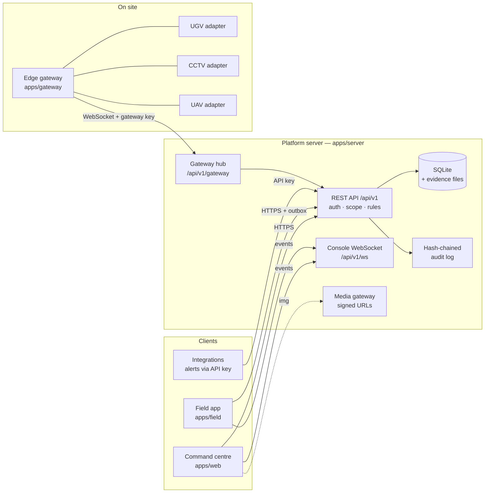

# Architecture

How the platform implements PRD R1 §6–§8. Read this with
[`ADAPTER_CONTRACT.md`](ADAPTER_CONTRACT.md) (device side) and [`OPERATIONS.md`](OPERATIONS.md) (running it).

## Components



| Part | Responsibility | Where |
|---|---|---|
| Shared domain | Types, role matrix, freshness thresholds, state machines, wire protocol, site geometry | `packages/shared` |
| Platform server | Identity, org/site scoping, incidents, missions, approvals, commands, evidence, reports, audit, backups, media URLs, events | `apps/server` |
| Edge gateway | Runs device adapters on site, holds the vehicle-side safety behaviour, speaks `ps-gw/1` to the server | `apps/gateway` |
| Command centre | Situation map (2D/3D), incident workflow, mission planner, live mission, evidence & replay, reports, admin | `apps/web` |
| Field app | Responder tasks, on-scene and report, photos, offline outbox | `apps/field` |

The server is one process. Telemetry ingest and the console event stream run inside it but on
separate code paths (gateway hub → in-memory device cache → event bus), so a burst of telemetry
does not block incident handling. For larger sites, the hub can move into its own process behind
the same protocol without client changes.

## Data model

`Organization → Site → Zone → Asset`. Every row carries `org_id`; operational rows also carry
`site_id`. Positions are metres in a local site grid; each site stores its coordinate reference
(`sites.crs`) so a transform to WGS 84 can be added per site. Altitudes are labelled with their
datum (`m-site-datum`).

| Table | Holds | Notes |
|---|---|---|
| `orgs`, `sites`, `users`, `sessions`, `api_keys` | Identity and tenancy | Passwords: scrypt. Tokens and keys stored as SHA-256 hashes only |
| `devices` | Registered devices and their latest declared capabilities | Adapters can only update registered devices |
| `telemetry` | Every sample with `source_time` and `received_time` | Used for playback (F15) |
| `incidents`, `missions`, `commands`, `assignments` | Workflow state | JSON document + indexed columns |
| `timeline` | Events with source and received time (F10) | |
| `evidence` | Metadata, SHA-256, relative file path, retention class | Files under `DATA_DIR/evidence/<org>/` |
| `audit` | Append-only, per-org hash chain | `prev_hash` + `hash`; `/audit/verify` recomputes |
| `idempotency` | Results of retried field actions | |

## Rules live on the server

Every mutating request goes through `Platform.require()`:

1. **Role** — `MATRIX` in `packages/shared/src/policy.ts` (PRD §3). Viewing video, exporting
   evidence and commanding devices are separate permissions (F13). Administrators manage users,
   keys, devices and backups but cannot see incident data or command devices.
2. **Scope** — the actor's org and sites. Objects outside scope return 404, so their existence
   does not leak across organisations. Field responders only see incidents they are assigned to.
3. **Replay** — requests sent with `X-Console-Mode: replay` cannot change anything (F12).
4. **Step-up** — approving missions, exporting evidence, handing over control and admin changes
   need a password check within the last 15 minutes (risk-based authentication, PRD §8).
5. **State machine** — `packages/shared/src/states.ts` lists every allowed transition (PRD §4).

The UI hides what a role cannot do, but never relies on that.

## Command lifecycle (F06–F09)

```mermaid
sequenceDiagram
  participant O as Operator console
  participant S as Server
  participant G as Edge gateway / adapter
  O->>S: POST /commands {missionId, type, idempotencyKey}
  S->>S: role · control holder · mission state · plan approved · telemetry fresh
  S-->>O: command (authorized / sent)
  S->>G: command {commandId, idempotencyKey, expiresAt, route}
  G-->>S: acknowledged → executing → succeeded (or rejected)
  S-->>O: command updates over WebSocket
  Note over S: no ack in 5 s → timed_out (result unknown)
  Note over S,G: never re-sent; expired commands are never delivered
```

- **Idempotency:** the same key returns the existing command; the adapter also dedupes.
- **Expiry:** commands carry `expiresAt` (10 s). The adapter rejects expired commands.
- **Certainty:** the mission only changes state when the device confirms. A stop request shows
  "waiting for confirmation" and becomes "timed out / unknown" if the device does not answer.
- **Link loss:** telemetry older than 5 s is STALE, older than 15 s OFFLINE. New start/resume
  commands are refused while stale. The vehicle stops itself (adapter failsafe, ~1.5 s). On
  reconnect it reports the failsafe stop, the mission goes to Paused, nothing queued is replayed,
  and the operator must resume.
- **Control lock (F08):** one control holder per device, taken when the operator accepts the
  mission. Handover is a supervisor action, logged in audit and the incident timeline.

## Media

The media gateway issues signed URLs (HMAC over org, device, user and expiry, 60 s). The URL
works in an `` tag without a session but cannot be reused by another user or after expiry.
In this release the frames are simulated; a real deployment points the same session endpoint at
a streaming server (e.g. WebRTC/HLS gateway) and keeps the signing scheme.

## Environments (F12)

| `ENV_MODE` | Data label | Devices | Demo controls |
|---|---|---|---|
| `demo` | SIMULATION | Simulated adapters only (others are refused) | Enabled |
| `pilot` | LIVE, or MIXED DEMO if any simulated device is registered | Any registered device | Disabled (404) |

API keys are created per environment (`sk_demo_…`, `sk_sandbox_…`, `sk_pilot_…`). The seeded
developer sandbox is a separate organisation with its own keys.

## Offline demo build

`npm run build:demo` produces one self-contained HTML file that runs the whole scenario in the
browser (no server). It uses the same shared rules and is clearly labelled SIMULATION · OFFLINE.
It is the booth fallback when the network or hardware fails (UXUI §9).
