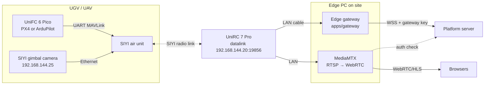

# Connecting SIYI hardware

How to connect a **SIYI UniFC 6 Pico** flight controller, **SIYI gimbal cameras** (ZT30, ZR30,
ZR10, ZT6, A8 mini) and a **SIYI UniRC 7 Pro** handheld ground station to the platform.

> **Status:** the adapters are written against SIYI's published SDK and the MAVLink standard,
> and tested against protocol-accurate simulators (`apps/gateway/test/hardware.test.ts`).
> They have **not yet been run on the physical devices**. Devices connect with integration status
> **TESTING** until the hardware checklist below passes and the result is recorded.

## How it fits together



- The **pilot keeps the UniRC 7 Pro** and can take over at any time by changing mode on the
  remote. The platform reports the override and does not fight it.
- The **flight controller owns motion and failsafes**. The platform uploads the approved route
  and asks for AUTO, pause or hold, nothing lower level.
- **Video** never passes through the platform server. MediaMTX on the edge PC pulls RTSP from the
  camera and serves WebRTC to browsers. The platform signs a 60-second token per viewer, and
  MediaMTX asks the platform to check it.

## What the adapters do

| Device | Adapter | Protocol | Reads | Can do |
|---|---|---|---|---|
| UniFC 6 Pico (PX4 / ArduPilot) via UniRC 7 Pro | `mavlink` | MAVLink 2 over UDP to the UniRC datalink server `192.168.144.20:19856` (or the FC's own Ethernet port, `listen` mode) | Position (GLOBAL_POSITION_INT → site grid), heading, ground speed, battery, satellites, GPS accuracy (hAcc/eph), radio RSSI, mission progress, flight mode, armed state, critical STATUSTEXT | Upload the approved route (mission protocol), AUTO + MISSION_START, pause (DO_PAUSE_CONTINUE or HOLD), resume, stop (HOLD) |
| SIYI gimbal camera | `siyi-camera` | SIYI Gimbal Camera SDK over UDP `192.168.144.25:37260` | Gimbal yaw/pitch/roll, zoom level, recording state, firmware | Pan/tilt by speed or to an angle, centre, zoom in/out or to a level, take a photo, start/stop recording |

Confirmation rules are the same as for every device: a command shows **succeeded** only when
telemetry shows the effect (moving after start; speed 0 after pause/stop). Camera actions show
**confirmed** only when the camera answers; otherwise "sent, not confirmed".

**Safety defaults**
- No remote arming. If the vehicle is disarmed, start is refused with "Arm it on the remote
  after the safety check". Set `allowRemoteArm: true` only after a written risk assessment.
- If the flight controller stops sending heartbeats for 3 s, telemetry stops. The platform shows
  STALE, then OFFLINE, and refuses start/resume. The vehicle follows its own GCS failsafe.
- Commands are never re-sent after a reconnect. Expired commands are never delivered.

## Setup

### 1. Flight controller (UniFC 6 Pico)

Wire a TELEM UART to the SIYI air unit's datalink port.

**ArduPilot (Rover / Copter)**

| Parameter | Value | Why |
|---|---|---|
| `SERIALn_PROTOCOL` | `2` (MAVLink 2) | on the UART wired to the air unit |
| `SERIALn_BAUD` | `115` | must match the UniRC datalink baud (115200 by default in the SIYI app) |
| `FS_GCS_ENABLE` | `1` | act when the ground station link is lost |
| `FS_ACTION` (Rover) | `2` Hold | stop in place on link loss (Rover) |
| `FS_GCS_ENABLE` action (Copter) | RTL or Land per site plan | |
| `SRn_*` stream rates | ≥ 1 Hz for position, extended status, extra | the adapter also requests 1 Hz with SET_MESSAGE_INTERVAL |

**PX4**: set `MAV_n_CONFIG` to the TELEM port, `NAV_DLL_ACT` (data-link loss action) per the
site safety plan, and check `COM_DL_LOSS_T`.

Arm, mode-switch and kill switches stay on the UniRC 7 Pro channels as usual.

### 2. UniRC 7 Pro

- In the SIYI app, set the datalink baud to match the flight controller (115200).
- Plug the edge PC into the **LAN** port. Give the PC a static address on `192.168.144.0/24`
  (for example `192.168.144.50`), not one already used by the link (`.11`, `.12`, `.20`, `.25`…).
- Check from the PC: `ping 192.168.144.25` (camera). QGroundControl on the PC with a UDP link to
  server `192.168.144.20:19856` should show the vehicle; close QGroundControl before starting the
  gateway, or use different ports.
- Don't run UniGCS video and the platform video at full bitrate at the same time; it shares the
  image link bandwidth (SIYI guidance).

### 3. Register on the platform

Real devices need the **pilot** environment, or the **developer sandbox** for bench tests. The
demo organisation accepts simulated adapters only.

1. Administration → Edge gateways and devices → register `UGV-02` (UGV) and `CAM-ZT30-01` (CCTV).
2. Administration → API keys → create a **gateway** key. Copy it once.
3. Make sure the site's WGS 84 anchor is the same on the platform and in the gateway config.

### 4. Edge PC

```bash
cp apps/gateway/config/siyi-site.example.json deploy/edge/site.json   # edit ids, key, geo, stream
cd deploy/edge && docker compose up -d                                 # gateway + MediaMTX
```

Without Docker: `GATEWAY_CONFIG=deploy/edge/site.json npm start -w @13store/gateway`.

`site.json` fields: `geo` (origin latitude/longitude of the site grid and rotation), and per
device `type` (`mavlink` / `siyi-camera` / `simulated`), `deviceId`, `profile`
(`ardupilot-rover`, `ardupilot-copter`, `px4-rover`, `px4-multicopter`), `link`, `pos` for a
fixed camera, and `stream.whep` for the browser video URL.

## Hardware test checklist (before marking VERIFIED)

Run on the real vehicle in a closed area, with the pilot holding the UniRC 7 Pro and the vehicle's
physical E-stop in reach. Record firmware versions in the device's "firmware tested" field.

| # | Check | Pass when |
|---|---|---|
| 1 | Position on the map | Vehicle stands on a surveyed point; map position within GNSS accuracy shown |
| 2 | Heading | Turning the vehicle turns the icon the same way |
| 3 | Start refused when disarmed | Clear message; no mission uploaded |
| 4 | Route upload and start | Vehicle drives the approved route; command shows succeeded only once moving |
| 5 | Pause / resume | Vehicle stops; "succeeded" only at speed 0; resumes on resume |
| 6 | Stop request | Vehicle holds; mission ends |
| 7 | Route changed after approval | Start refused until re-approved |
| 8 | Pilot override | Mode switch on the remote is reported; platform does not switch back |
| 9 | Link loss | Unplug the edge PC from the UniRC: STALE ≤ 5 s, vehicle follows its failsafe; re-plug: failsafe reported, nothing replayed, mission paused |
| 10 | Physical E-stop | Works with the platform disconnected |
| 11 | Camera control | Pan/tilt/zoom/photo/record each confirmed by the camera |
| 12 | Video | Browser shows live video; an expired link is refused; another org cannot view |
| 13 | Latency | Measure command → acknowledgement and glass-to-glass video delay; record both |

## Not covered yet

- Real video latency figures, multi-vehicle on one link, and SIYI MK15/HM30 links (same
  approach; IPs and ports may differ by model and firmware).
- UAV flight at the booth stays simulated until a separate flight test passes (PRD §10).
