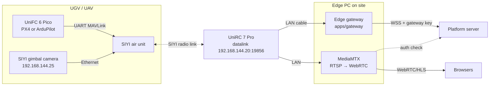

# Connecting SIYI hardware

How to connect a **SIYI UniFC 6 Pico** flight controller, **SIYI gimbal cameras** (ZT30, ZR30,
ZR10, ZT6, A8 mini) and a **SIYI UniRC 7 Pro** handheld ground station to the platform.

> **Status:** the adapters are written against SIYI's published SDK and the MAVLink standard,
> and tested against protocol-accurate simulators (`apps/gateway/test/hardware.test.ts`).
> They have **not yet been run on the physical devices**. Devices connect with integration status
> **TESTING** until the hardware checklist below passes and the result is recorded.
>
> **Bench, 2026-10-22:** the MAVLink path UniFC 6 Pico → air unit → UniRC 7 Pro → PC works:
> heartbeat at 1 Hz and a full parameter read with the read-only probe in `tools/siyi-bench`.
> Setup sections 1 and 2 below reflect what that test needed.

## How it fits together



- The **pilot keeps the UniRC 7 Pro** and can take over at any time by changing mode on the
  remote. The platform reports the override and does not fight it.
- The **flight controller owns motion and failsafes**. The platform uploads the approved route
  and asks for AUTO, pause or hold, nothing lower level.
- **Video** never passes through the platform server. MediaMTX on the edge PC pulls RTSP from the
  camera and serves WebRTC to browsers. The platform signs a 60-second token per viewer, and
  MediaMTX asks the platform to check it.

## What the adapters do

| Device                                         | Adapter       | Protocol                                                                                                              | Reads                                                                                                                                                                                        | Can do                                                                                                                     |
| ---------------------------------------------- | ------------- | --------------------------------------------------------------------------------------------------------------------- | -------------------------------------------------------------------------------------------------------------------------------------------------------------------------------------------- | -------------------------------------------------------------------------------------------------------------------------- |
| UniFC 6 Pico (PX4 / ArduPilot) via UniRC 7 Pro | `mavlink`     | MAVLink 2 over UDP to the UniRC datalink server `192.168.144.20:19856` (or the FC's own Ethernet port, `listen` mode) | Position (GLOBAL_POSITION_INT → site grid), heading, ground speed, battery, satellites, GPS accuracy (hAcc/eph), radio RSSI, mission progress, flight mode, armed state, critical STATUSTEXT | Upload the approved route (mission protocol), AUTO + MISSION_START, pause (DO_PAUSE_CONTINUE or HOLD), resume, stop (HOLD) |
| SIYI gimbal camera                             | `siyi-camera` | SIYI Gimbal Camera SDK over UDP `192.168.144.25:37260`                                                                | Gimbal yaw/pitch/roll, zoom level, recording state, firmware                                                                                                                                 | Pan/tilt by speed or to an angle, centre, zoom in/out or to a level, take a photo, start/stop recording                    |

**Equipment tab.** Each adapter declares the parts it talks to (`components` in the hello:
flight controller, GNSS, radio, battery, 4-in-1 module for the vehicle; camera, gimbal and media
stream for the SIYI camera; Nav2, SLAM and battery for the ROS 2 vehicle). Every part starts as
_Interface verification pending_ and turns OK the first time the adapter actually hears from it
(heartbeat, GPS_RAW_INT, RADIO_STATUS, SYS_STATUS, a relay acknowledgement, an SDK firmware
reply, a SLAM pose…), with the version it read where the protocol gives one. Status changes
ride in telemetry (`components: [{id, status, version?, detail?}]`), so the device panel shows
which interfaces have really been exercised on hardware, separate from the device being online
and from the adapter's TESTING / VERIFIED label. Name the parts in the device config
(`flightController`, `radio`) so the tab reads "SIYI UniFC 6 Pico" rather than "Flight controller".

**In the console**, any device with a gimbal shows a control pad under its video: hold an arrow
to pan/tilt (slower when zoomed in), − / + to zoom, centre, photo, record, with the gimbal
attitude, zoom and REC drawn over the video. Keyboard: arrow keys, + / −, C. Dispatchers,
supervisors and operators may use it; on a vehicle, only the operator holding control. Every
action is audited. Photos and recordings are saved on the camera's SD card, not the platform.

**Pointing at alerts.** When an alert arrives with a position, the platform turns the nearest
fixed gimbal camera that can see it (in range, within the ±135° pan limit, no building in the
way) and zooms to frame about 8 m of scene. The incident timeline says which camera turned and
whether the camera confirmed it. A camera an operator used in the last minute is left alone:
manual control always wins. Operators can also press **Point at INC-…** under the video, or call
`POST /api/v1/devices/{id}/aim`. This needs the camera's `mount` in `site.json`: `bearingDeg`
(compass bearing the camera faces when centred, 0 = north, clockwise), `heightM`, `fovDeg`
(vertical field of view at 1×) and `rangeM`.

**Saving bandwidth.** Video is pulled from the camera only while someone watches
(`sourceOnDemand`); the browser drops its stream 10 s after the view is hidden or scrolled away.
If the camera has a low-resolution sub-stream, the console shows it by default (SD) with an HD
switch. Add `rtspSub` / `whepSub` to the stream config and a `-sub` path in `mediamtx.yml`. Not
every SIYI model or firmware has a sub-stream; check the manual.

Confirmation rules are the same as for every device: a command shows **succeeded** only when
telemetry shows the effect (moving after start; speed 0 after pause/stop). Camera actions show
**confirmed** only when the camera answers; otherwise "sent, not confirmed".

**Safety defaults**

- No remote arming. If the vehicle is disarmed, start is refused with "Arm it on the remote
  after the safety check". Set `allowRemoteArm: true` only after a written risk assessment.
- If the flight controller stops sending heartbeats for 3 s, telemetry stops. The platform shows
  STALE, then OFFLINE, and refuses start/resume. The vehicle follows its own GCS failsafe.
- Commands are never re-sent after a reconnect. Expired commands are never delivered.

## Setup

### 1. Flight controller (UniFC 6 Pico)

**Firmware.** The board ships with **ArduCopter** (ours reported `ArduCopter V4.6.3 (92b0cd78)`,
board `SIYI-UniFC-6-PICO`). That is a SIYI build: the official ArduPilot servers have no Copter
build for this board. A ground vehicle needs **ArduPilot Rover** (decision D-34):

| Use               | Firmware                                                       | Source                                                                                                                                                                                                                  |
| ----------------- | -------------------------------------------------------------- | ----------------------------------------------------------------------------------------------------------------------------------------------------------------------------------------------------------------------- |
| Bench tests (now) | `ArduRover V4.8.0-dev`, built 2026-10-21, ArduPilot `9c412baa` | `firmware.ardupilot.org/Rover/latest/SIYI-UniFC-6-PICO/ardurover.apj`. A development build, and the only official Rover build for this board: Rover `stable` and `beta` had none on 2026-10-22                          |
| Launch event      | Rover **stable** for the UniFC 6 Pico                          | Requested from SIYI. If none arrives in time, pin one dated `latest` build, run the full hardware checklist on it, and do not change it before the event                                                                 |

`latest` is rebuilt every day, so the file downloaded later may differ from the one above. After
flashing, record the version the board prints at boot. The bench probe keeps it in the report under
`statusText` (for example `ArduRover V4.8.0-dev (xxxxxxxx)`).

To flash: Mission Planner, USB only, not connected → Setup → Install Firmware → **Load custom
firmware** → `ardurover.apj`. The Rover button there only offers `stable`, which has no build for
this board. Use the `.apj`, not `ardurover_with_bl.hex`, which also rewrites the bootloader.
Changing the vehicle type resets every parameter and calibration: load
`deploy/vehicle/tracked-ugv-rover.param`, then redo accelerometer, compass and radio calibration.

**Wiring.**

| Air unit                                       | UniFC 6 Pico | Notes                                                                                                                                                                       |
| ---------------------------------------------- | ------------ | --------------------------------------------------------------------------------------------------------------------------------------------------------------------------- |
| UART 1 / Datalink 1 (GH1.25 3-pin: TX, RX, GND) | TELEM1 (6-pin) | Needs an adapter cable (SIYI sells one; the Pico box has a TELEM1 adapter). Cross TX↔RX, join GND, **leave 5 V unconnected**: the air unit has its own XT30 supply. |
| S.Bus out (GH1.25 2-pin)                        | RC IN (3-pin)  | Also needs an adapter. RC IN takes S.Bus or PPM with no serial setting.                                                                                             |
| —                                              | GPS1         | GNSS + compass module                                                                                                                                                       |

Pin orders are only in the interface diagrams of the two manuals; check both before making a cable.

ArduPilot port map (UniFC 6 Pico manual §1.3, confirmed on the bench): `SERIAL1` = TELEM1,
`SERIAL2` = TELEM2, `SERIAL3` = GPS1, `SERIAL4` = GPS2, `SERIAL5` = the port labelled SERIAL5,
`SERIAL6` = USB2. Only TELEM1 and TELEM2 have RTS/CTS.

**ArduPilot (Rover / Copter)**

| Parameter                       | Value                                       | Why                                                                                         |
| ------------------------------- | ------------------------------------------- | ------------------------------------------------------------------------------------------- |
| `SERIAL1_PROTOCOL`              | `2` (MAVLink 2)                             | TELEM1, wired to the air unit                                                               |
| `SERIAL1_BAUD`                  | `115`                                       | factory value is `57` (57600). Whatever you choose, Datalink 1 baud on the remote must match |
| `BRD_SER1_RTSCTS`               | `0`                                         | only TX, RX and GND are wired, so turn flow control off rather than leave it on auto-detect |
| `FS_GCS_ENABLE`                 | `1`                                         | act when the ground station link is lost (factory value is `0`)                             |
| `FS_ACTION` (Rover)             | `2` Hold                                    | stop in place on link loss (Rover)                                                          |
| `FS_GCS_ENABLE` action (Copter) | RTL or Land per site plan                   |                                                                                             |
| `SRn_*` stream rates            | ≥ 1 Hz for position, extended status, extra | the adapter also requests 1 Hz with SET_MESSAGE_INTERVAL                                    |

**PX4**: set `MAV_n_CONFIG` to the TELEM port, `NAV_DLL_ACT` (data-link loss action) per the
site safety plan, and check `COM_DL_LOSS_T`.

Arm, mode-switch and kill switches stay on the UniRC 7 Pro channels as usual.

### 2. UniRC 7 Pro

- In UniGCS on the remote, open the datalink settings and set **Datalink 1 connection mode =
  UDP**. UDP mode runs a server at `192.168.144.20:19856` (UniRC 7 manual §6.3) that devices on
  the remote's LAN port or Wi-Fi can reach. **UART mode sends nothing to the LAN**: it feeds the
  remote's internal serial port (`/dev/ttyHS3`) for apps running on the remote. Bluetooth and
  Type-C are the other modes.
- Set **Datalink 1 baud** to the flight controller's `SERIAL1_BAUD`: 57600 from the factory,
  115200 with our parameter file. Change both together. If they differ, bytes still reach the
  PC but no MAVLink decodes.
- The PC's own UDP port must not be 19856, or it clashes with the server.
- Plug the edge PC into the **LAN** port. Give the PC a static address on `192.168.144.0/24`
  (for example `192.168.144.50`), not one already used by the link (`.11`, `.12`, `.20`, `.25`…).
- Check from the PC: `ping 192.168.144.25` (camera). QGroundControl on the PC with a UDP link to
  server `192.168.144.20:19856` should show the vehicle; close QGroundControl before starting the
  gateway, or use different ports.
- Don't run UniGCS video and the platform video at full bitrate at the same time; it shares the
  image link bandwidth (SIYI guidance).

**Checking the link one layer at a time** (the order used on the bench):

| Step                                                       | Pass when                     | If not                                                                                    |
| ---------------------------------------------------------- | ----------------------------- | ----------------------------------------------------------------------------------------- |
| `ping 192.168.144.20` and `.12`                            | replies in 1–2 ms             | LAN cable, PC address                                                                     |
| `ping 192.168.144.11` (air unit)                           | replies in ~20 ms (radio hop) | air unit power (XT30), binding                                                            |
| `npx tsx tools/siyi-bench/probe.ts` (from `platform/`)     | autopilot heartbeat PASS      | the probe says which: no data at all, or bytes that are not MAVLink (baud mismatch)      |

### 3. Register on the platform

Real devices need the **pilot** environment, or the **developer sandbox** for bench tests. The
demo organisation accepts simulated adapters only.

1. Administration → Edge gateways and devices → register `UGV-02` (UGV) and `CAM-ZT30-01` (CCTV).
2. Administration → API keys → create a **gateway** key. Copy it once.
3. Make sure the site's WGS 84 anchor is the same on the platform and in the gateway config.

### 4. Edge PC

```bash
cp apps/gateway/config/siyi-site.example.json deploy/edge/site.json   # edit ids, key, geo, stream
cd deploy/edge && docker compose up -d                                 # gateway + MediaMTX
```

Without Docker: `GATEWAY_CONFIG=deploy/edge/site.json npm start -w @13store/gateway`.

The gateway keeps its command ledgers (once-only execution across restarts) in the `gateway-data`
volume, or in `GATEWAY_DATA_DIR` without Docker (default `./data/gateway`). Keep it: `docker compose down -v`
deletes it. See [ADAPTER_CONTRACT.md §7](ADAPTER_CONTRACT.md).

`site.json` fields: `geo` (origin latitude/longitude of the site grid and rotation), and per
device `type` (`mavlink` / `siyi-camera` / `simulated`), `deviceId`, `profile`
(`ardupilot-rover`, `ardupilot-copter`, `px4-rover`, `px4-multicopter`), `link`, `pos` for a
fixed camera, `stream.whep` for the browser video URL, and `yawSign: -1` if "pan right" turns
the camera left (SIYI yaw sign can differ by model and mounting; check it in test 11).

### 5. Catalogue vehicles (D50 / D100 / D200) and the 4-in-1 module

Set `catalogId` (`D50`, `D100`, `D200`) on a `mavlink` device: the platform then shows the rated
specs, estimates the runtime left from the battery, and draws the right 3D model. The vehicles are
registered in their unarmed configuration; weapon stations are not integrated.

The **4-in-1 module** (two-way loudspeaker, searchlight, warning light, HD camera) connects in
three parts:

| Function                   | Path                                                                                                                                                                                                                 | Config                                                                      |
| -------------------------- | -------------------------------------------------------------------------------------------------------------------------------------------------------------------------------------------------------------------- | --------------------------------------------------------------------------- |
| Searchlight, warning light | Flight-controller relay outputs → `MAV_CMD_DO_SET_RELAY` (ArduPilot `RELAYn_PIN`, `RELAYn_DEFAULT`)                                                                                                                  | `payload: { module: 'loudhailer-4in1', spotlightRelay: 0, beaconRelay: 1 }` |
| Camera                     | RTSP to MediaMTX like any camera, or use the SIYI gimbal camera instead                                                                                                                                              | `stream`                                                                    |
| Loudspeaker                | The module's own audio link (not MAVLink). Preset announcements from the console are supported on the simulated units; for hardware, wire the module's audio input to the UniRC 7 Pro's audio or a separate intercom | —                                                                           |

## Hardware test checklist (before marking VERIFIED)

Run on the real vehicle in a closed area, with the pilot holding the UniRC 7 Pro and the vehicle's
physical E-stop in reach. Record firmware versions in the device's "firmware tested" field.

| #   | Check                        | Pass when                                                                                                                                  |
| --- | ---------------------------- | ------------------------------------------------------------------------------------------------------------------------------------------ |
| 1   | Position on the map          | Vehicle stands on a surveyed point; map position within GNSS accuracy shown                                                                |
| 2   | Heading                      | Turning the vehicle turns the icon the same way                                                                                            |
| 3   | Start refused when disarmed  | Clear message; no mission uploaded                                                                                                         |
| 4   | Route upload and start       | Vehicle drives the approved route; command shows succeeded only once moving                                                                |
| 5   | Pause / resume               | Vehicle stops; "succeeded" only at speed 0; resumes on resume                                                                              |
| 6   | Stop request                 | Vehicle holds; mission ends                                                                                                                |
| 7   | Route changed after approval | Start refused until re-approved                                                                                                            |
| 8   | Pilot override               | Mode switch on the remote is reported; platform does not switch back                                                                       |
| 9   | Link loss                    | Unplug the edge PC from the UniRC: STALE ≤ 5 s, vehicle follows its failsafe; re-plug: failsafe reported, nothing replayed, mission paused |
| 10  | Physical E-stop              | Works with the platform disconnected                                                                                                       |
| 11a | Point at alert               | Inject or trigger an alert at a surveyed point: camera centres on it (record the error in degrees); correct `bearingDeg` if needed         |
| 10a | 4-in-1 module                | Searchlight and warning light switch from the console and the state shows on the unit card; relays confirmed by the flight controller      |
| 11  | Camera control               | Pan/tilt/zoom/photo/record each confirmed by the camera; "pan right" turns right (else set `yawSign: -1`); pitch limits respected          |
| 12  | Video                        | Browser shows live video; an expired link is refused; another org cannot view                                                              |
| 13  | Latency                      | Measure command → acknowledgement and glass-to-glass video delay; record both                                                              |

## Not covered yet

- Real video latency figures, multi-vehicle on one link, and SIYI MK15/HM30 links (same
  approach; IPs and ports may differ by model and firmware).
- UAV flight at the booth stays simulated until a separate flight test passes (PRD §10).
