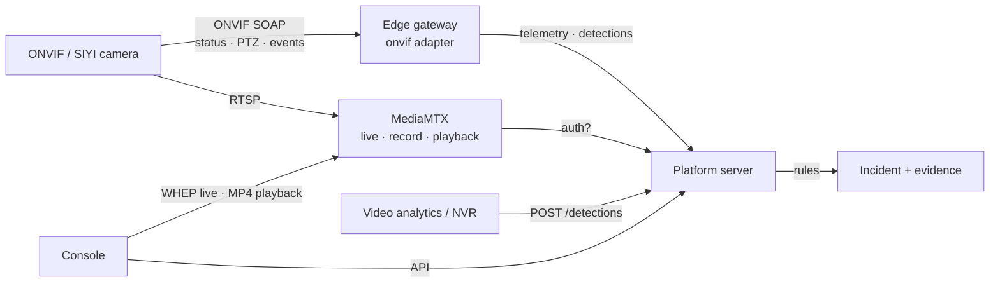

# Video: cameras, recordings and AI detections

How the platform works with the customer's cameras and video analytics. Three parts:

1. **Cameras** — any ONVIF camera (fixed, PTZ, thermal) through the `onvif` adapter; SIYI gimbal
   cameras through the `siyi-camera` adapter. Live video never passes through the platform
   server: the site media server (MediaMTX on the edge PC) re-streams RTSP to browsers as WebRTC
   and asks the platform whether each viewer is allowed (`POST /api/v1/media/auth`).
2. **Recordings** — MediaMTX records every camera path to disk; the console shows a recordings
   timeline per incident, plays any stretch back, and saves a stretch to the incident as
   checksummed evidence.
3. **Detections** — analytics systems, thermal cameras, NVRs and ONVIF camera events send
   detections; per-organisation rules decide whether a detection becomes an incident (with the
   frame as evidence), joins an open one, is logged, or ignored.



## ONVIF cameras

Supported: ONVIF Profile S/T devices (Hikvision, Dahua, Axis, Uniview, Bosch, Hanwha, thermal
bullets, PTZ domes …). The adapter speaks SOAP 1.2 with WS-UsernameToken digest authentication
and needs no library.

| Reads                                                                                                                                                                  | Can do                                                                          |
| ---------------------------------------------------------------------------------------------------------------------------------------------------------------------- | ------------------------------------------------------------------------------- |
| Device information (manufacturer, model, firmware, serial) → Equipment tab                                                                                             | Pan/tilt by speed or to an angle, home, zoom in/out or to a level (PTZ service) |
| Media profiles and the RTSP stream URI (for the media server)                                                                                                          | Take a photo (snapshot URI) → stored as evidence on the camera's incident       |
| PTZ position → gimbal readout, pointing at alerts                                                                                                                      | — recording runs on the media server, not the camera                            |
| Analytics events via pull-point subscription: motion, intrusion / line crossing, person, vehicle, fire, smoke, thermal temperature alarm, licence plate, crowd, tamper | Raised as detections; tamper becomes a device fault                             |

### Site configuration

Add to the gateway's `site.json` (see `apps/gateway/config/onvif-site.example.json`):

```json
{
  "type": "onvif",
  "deviceId": "CAM-PTZ-01",
  "model": "Hikvision DS-2DE4A425IWG-E",
  "host": "192.168.10.21",
  "username": "onvif",
  "password": "…",
  "pos": { "x": 262, "y": 152 },
  "mount": { "bearingDeg": 180, "heightM": 7, "fovDeg": 58, "rangeM": 200 },
  "panRangeDeg": 360,
  "tiltRangeDeg": 180,
  "maxZoom": 25,
  "stream": {
    "whep": "https://edge.example.com/cam-ptz-01/whep",
    "whepSub": "https://edge.example.com/cam-ptz-01-sub/whep",
    "playback": "https://edge.example.com:9996"
  }
}
```

- Create a dedicated ONVIF user on the camera (operator level is enough for PTZ; administrator
  is not needed). Set the camera's clock (NTP): WS-Security rejects a timestamp more than five
  minutes off.
- `panRangeDeg` / `tiltRangeDeg` / `maxZoom` turn ONVIF's normalised −1…1 / 0…1 into degrees and
  zoom levels. Check the camera's datasheet; a PTZ dome is usually 360° / 180° (−90…+90).
- `ptz: false` for fixed cameras; `events: false` if the camera's event service is noisy or
  disabled.
- XAddrs the camera returns often carry its own LAN or NAT address; the adapter keeps the path
  and always talks to `host`.
- Register the device under Administration before the gateway connects (kind `cctv`).

### Hardware checklist (before marking VERIFIED)

| #   | Check          | Pass when                                                                                                       |
| --- | -------------- | --------------------------------------------------------------------------------------------------------------- |
| 1   | Equipment tab  | Camera shows manufacturer, model, firmware; PTZ `ok`; media `ok`                                                |
| 2   | Live video     | WHEP stream plays in the console within 3 s; sub-stream on slow links                                           |
| 3   | PTZ pad        | Press and hold pans the right way; release stops within 0.5 s; readout follows                                  |
| 4   | Point at alert | Inject an alert at a surveyed point: camera centres on it; correct `bearingDeg` if needed                       |
| 5   | Photo          | Snapshot appears as evidence on the camera's open incident within 2 s                                           |
| 6   | Events         | Walk through the camera's intrusion zone: a detection appears (Administration → Detection rules → rule applied) |
| 7   | Link loss      | Unplug the camera: STALE ≤ 5 s, equipment shows offline; replug: recovers without restart                       |

## Recordings

### Media server

`deploy/edge/mediamtx.yml` records every path and serves them back:

```yaml
record: yes
recordPath: /recordings/%path/%Y-%m-%d_%H-%M-%S-%f
recordFormat: fmp4
recordSegmentDuration: 1h
recordDeleteAfter: 720h # 30 days; align with the customer's retention policy
playback: yes
playbackAddress: :9996
```

Playback requests go through the same `authMethod: http` check as live viewing: the platform
only allows `playback` of the path that belongs to the device in a valid viewer token.

### Console

Evidence & replay → **Recordings**: a timeline from five minutes before the alert to now, cyan
where video exists, red mark at the alert, amber mark at the replay cursor. Click to choose a
start, pick 30 s – 5 min, **Play** (MP4 streamed from the media server) or **Save to evidence**:
the platform fetches the MP4, stores it with a SHA-256 checksum under the incident (kind `clip`)
and audits `evidence.clip`. Simulated cameras have no media server: coverage comes from their
telemetry and playback is a labelled **SIMULATED RECORDING** storyboard, so the workflow can be
shown at the booth without hardware.

API: `GET /media/{id}/recordings?from&to`, `POST /media/{id}/clip {start, duration}`,
`POST /incidents/{id}/evidence/clip {deviceId, start, duration}` (see API.md).

## Detections and rules

### Sending detections

Any system with an **integration API key** posts one detection or a list:

```bash
curl -X POST https://platform.example.com/api/v1/detections \
  -H "Authorization: Bearer sk_pilot_…" -H "Content-Type: application/json" \
  -d '{"type":"person","confidence":0.87,"deviceId":"CAM-PTZ-01","source":"DeepinView",
       "bbox":[0.47,0.49,0.10,0.39],"externalId":"evt-1001",
       "snapshot":{"mime":"image/jpeg","base64":"…"}}'
# → {"id":"DET-00012","outcome":"incident","incidentId":"INC-031","ruleId":"intrusion",…}
```

| Field                  | Meaning                                                                                                              |
| ---------------------- | -------------------------------------------------------------------------------------------------------------------- |
| `type`                 | `person`, `vehicle`, `intrusion`, `loitering`, `crowd`, `fire`, `smoke`, `thermal_hotspot`, `motion`, `lpr`, `other` |
| `confidence`           | 0–1 (missing = 1, a plain sensor contact)                                                                            |
| `deviceId`             | Camera or sensor on the platform; gives the zone, position and the incident's camera                                 |
| `source`               | Analytics system or model name shown on the incident                                                                 |
| `zone`, `place`, `pos` | Where; default from the device                                                                                       |
| `bbox`                 | Normalised box in the frame                                                                                          |
| `attributes`           | `temperatureC` (thermal), `plate` (LPR), `count` (crowd), `label`                                                    |
| `snapshot`             | JPEG/PNG/WebP/SVG frame, stored as evidence when an incident is raised                                               |
| `externalId`           | The sender's own id; repeats return the first outcome (`duplicate`)                                                  |

ONVIF camera events arrive the same way through the gateway. Every detection is stored
(`GET /detections`, `GET /detections/stats`) and counted in `ps_detections_total{type,outcome}`.

### Rules

Administration → **Detection rules**. Rules are tried top to bottom; the first match decides.

| Rule field       | Meaning                                                                                                                                                          |
| ---------------- | ---------------------------------------------------------------------------------------------------------------------------------------------------------------- |
| types            | Detection types the rule covers                                                                                                                                  |
| min. confidence  | Below it the rule does not match                                                                                                                                 |
| min. temperature | Thermal hotspots only: ignore readings below it                                                                                                                  |
| zones, hours     | Only in these zones / between these local times (may wrap midnight)                                                                                              |
| action           | **Raise incident** (severity, cooldown), **Log only**, **Ignore**                                                                                                |
| cooldown         | Another detection of the same type from the same device within this window joins the open incident ("… again" on the timeline) instead of raising a second alarm |

Defaults: person/intrusion/loitering ≥ 60 % → incident (medium, 5 min cooldown); fire/smoke or
thermal hotspot ≥ 60 °C → incident (high, 10 min); crowd → incident (low); vehicles and plates →
log only; plain motion → ignore. A detection no rule covers is logged. Rules are stored per
organisation and audited (`admin.settings_update`). Logged detections expire with the
_Data retention_ setting; detections that raised an incident live and die with the incident.

### Outcomes

| Outcome     | Meaning                                                                                                                   |
| ----------- | ------------------------------------------------------------------------------------------------------------------------- |
| `incident`  | New incident; frame stored as evidence; "Detection details" on the timeline; camera auto-pointed when a position is given |
| `merged`    | Joined the open incident from the same device (cooldown)                                                                  |
| `logged`    | Stored for the record and KPIs; no alarm                                                                                  |
| `ignored`   | Matched an ignore rule                                                                                                    |
| `duplicate` | Same `externalId` seen before                                                                                             |

## Status

| Part                 | Status                                                                                                                                                                       |
| -------------------- | ---------------------------------------------------------------------------------------------------------------------------------------------------------------------------- |
| ONVIF adapter        | **TESTING** — written to the ONVIF Profile S/T specifications, verified against a protocol-accurate fake camera (`apps/gateway/test/onvif.test.ts`); not yet run on hardware |
| Recordings           | **TESTING** — MediaMTX playback API, verified against a fake playback server (`apps/server/test/video.test.ts`)                                                              |
| Detections and rules | **Done** — `video.test.ts`: rules, ingest, cooldown merge, thermal threshold, gateway events, admin changes                                                                  |
